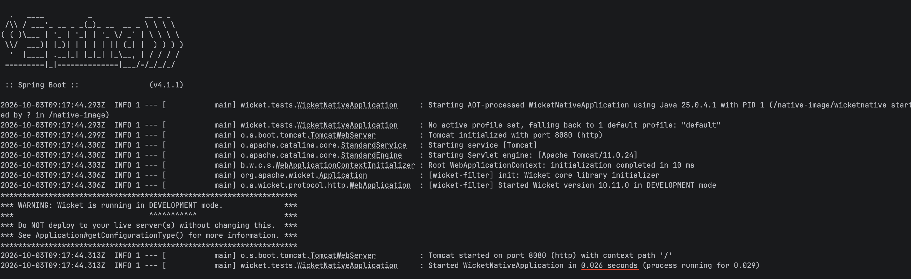
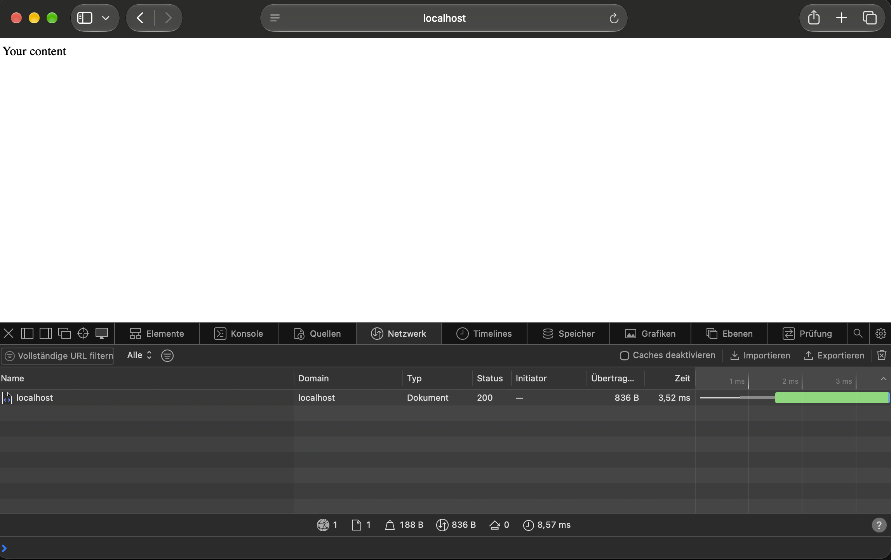
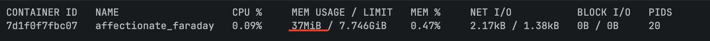

# How to native compile
1. Run `mvn verify`
2. run command `docker build -t testimg .`
3. run command `docker images` to find the image id
4. run command `docker run -p 8080:8080 --rm testimg` to run the actual image
5. Access via browser: http://localhost:8080

# Container

# Browser

# Resources
